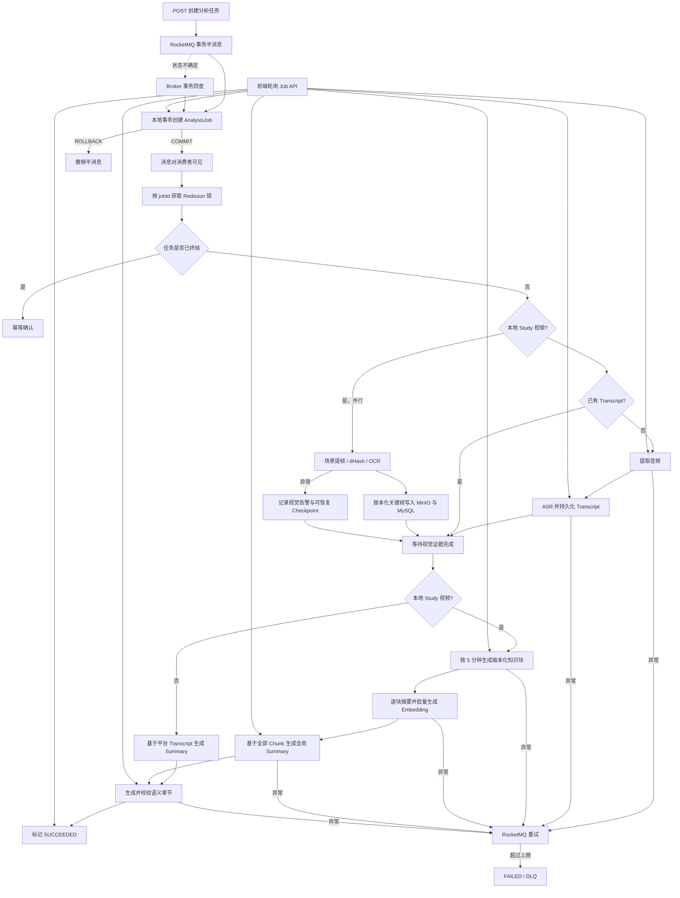
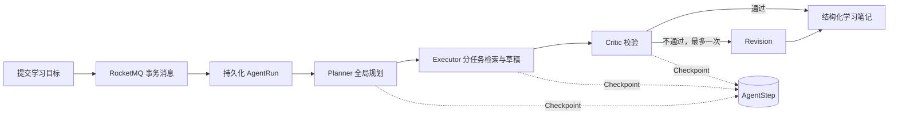

# VedioMind

面向长视频的 AI 内容理解平台。用户可以上传本地视频，或粘贴 Bilibili/YouTube 公共视频链接；系统复用本地 ASR 或平台字幕完成内容总结、章节生成和带引用问答，并在前端展示可恢复的任务进度。

> 当前重点是项目演示与异步架构闭环。完整鉴权、用量限制和第三方平台长期治理仍在 Roadmap 中，不建议直接部署到公网。

## 核心能力

- 本地视频进入 Study Mode：浏览器使用 S3 Multipart 直传 MinIO，支持暂停、续传、取消、真实进度和失败分片重试；Bilibili/YouTube URL 进入 Quick Insight，只读取平台字幕，不下载完整视频。
- Study Mode 会并行提取场景关键帧，使用 3 秒场景防抖、dHash 去重和 Tesseract 中英文 OCR 建立视觉证据；图片、时间戳、OCR 质量和处理版本分别持久化到 MinIO 与 MySQL，并与句级字幕组装为内部 VideoContext。
- Study Mode 将 VideoContext 聚合为版本化的 5 分钟知识块，逐块持久化摘要、关键词和阿里云 `text-embedding-v4` 向量；失败后从未完成块继续，最终总结覆盖全部知识块而不是只读取召回片段。
- Study Mode 问答使用当前问题与上一轮对话执行 Chunk 向量、关键词混合检索，再回到原始句级字幕生成带引用回答；Quick Insight 继续直接使用平台字幕。
- Study Mode 提供持久化学习助手：Planner 将目标拆成最多 3 个子任务，Executor 按任务检索字幕与 OCR，Critic 校验证据并生成核心结论、知识点和 3 道自测题；最多修订一次，所有引用由后端校验。
- 视频内容工作台集成本地原生播放器、平台官方嵌入播放器、自动章节导航、时间戳字幕联动、AI 总结、字幕搜索、复制、导出和带原文引用的持久化多轮问答。
- MinIO Bucket 保持私有，数据库只保存对象 Key，播放使用短时效预签名 URL。
- FFmpeg 提取 16kHz 单声道 PCM，阿里云 Paraformer 输出句子级时间戳；DeepSeek 生成分块摘要、全局总结和语义章节。
- RocketMQ 事务消息保证“任务落库”和“消息投递”不会只成功一边。
- 独立 `AnalysisJob` 状态机记录阶段、进度、重试次数和失败原因。
- 消费失败由 RocketMQ 重试；达到上限后标记 `FAILED` 并进入死信流程。
- Redisson Job 锁与数据库终态检查共同处理重复投递和并发消费。
- 视觉分支使用媒体级锁、受限线程池和阶段 Checkpoint；画面处理失败不会阻塞字幕总结、章节和问答，用户可以重新分析以只补失败产物。
- 时间戳 Transcript Segment 在 ASR 完成后立即持久化，重试不会重复执行已经成功的昂贵阶段。
- URL 导入采用平台白名单、规范化地址和受限重定向；Bilibili 使用专用元数据/字幕 API，YouTube 由 yt-dlp 只解析元数据和字幕地址。
- 章节生成只返回 Transcript Segment ID，后端校验锚点并派生章节时间；已保存章节在任务重试时直接复用。
- 前端按媒体查询活动 Job，页面刷新后仍可恢复当前任务。
- Flyway 管理数据库结构，新环境无需手工建表。

## 视频内容工作台

上传本地视频或解析网络链接后，前端会进入 `/media/{mediaId}`：

- 本地上传通过 MinIO 预签名 URL 直接播放，支持 Range 请求与时间跳转。
- URL 来源不下载第三方视频，使用 Bilibili/YouTube 官方嵌入播放器；点击章节、字幕时间或问答引用会在工作台内定位到对应位置。
- 工作台按媒体恢复正在执行的分析任务，不依赖浏览器保存 `jobId`。
- AI 总结使用 Marked 渲染，并通过 DOMPurify 清理不可信 HTML。
- 章节导航随本地视频播放进度高亮；点击章节可跳转本地播放器或更新平台嵌入播放器的起始位置。
- 字幕支持本地播放高亮、点击时间跳转、搜索、复制，以及带时间码的 TXT/Markdown 导出。
- 关键帧和 OCR 作为内部证据供后续检索、问答与 Agent 使用，不直接向普通用户展示原始 OCR 卡片；URL 视频因不下载原文件，其 VideoContext 明确标记视觉模态不适用。
- 视频问答按媒体持久化会话、消息与引用快照，支持会话切换和刷新恢复；最近 6 轮对话帮助模型理解指代，Study Mode 使用上一轮问答召回 Top 4 知识块并回源原始句级字幕，URL 视频继续使用完整平台字幕。
- Study Mode 的“学习助手”异步生成结构化学习笔记；任务历史和当前阶段可在刷新后恢复，字幕与画面文字引用均可点击跳转播放器。
- 模型只返回 Segment ID，后端校验后再回填原文和时间戳；引用以快照保存，点击后按来源跳转本地播放器或平台嵌入播放器。
- 当前保证浏览器兼容视频的直接播放；其他 FFmpeg 可处理的格式仍可分析，并显示明确的播放失败状态。

## 异步分析链路



任务状态流转：

```text
QUEUED
  → PREPARING
  → EXTRACTING_AUDIO
  → TRANSCRIBING
  → PROCESSING_VISUAL_EVIDENCE（仅在视觉分支仍在运行时出现）
  → BUILDING_KNOWLEDGE_INDEX（仅本地 Study 视频）
  → SUMMARIZING
  → GENERATING_CHAPTERS
  → SUCCEEDED

任一处理阶段异常 → RETRYING → 下一次消费
超过重试上限     → FAILED
```

这里选择 RocketMQ 事务消息而不是额外引入 Outbox：项目已经依赖 RocketMQ，事务消息能够以更少的组件完成当前所需的“本地任务记录 + MQ 投递”一致性。消费者侧的幂等、状态恢复和重试仍由 `AnalysisJob`、Redisson 与 RocketMQ 共同完成。

学习助手复用同一事务生产者，但使用独立 Topic、Consumer 和持久化状态：



每次模型与检索调用前先持久化预算消耗；成功阶段立即写入 `video_agent_steps`，RocketMQ 重投时从最近成功阶段继续，不重复执行已经完成的 Executor。单任务最多 3 个子任务、9 次生成调用、6 次检索调用和 10 分钟执行时间。

## 技术栈

| 层次 | 技术 |
| --- | --- |
| 前端 | Vue 3、Vue Router、Axios、Vite、Marked、DOMPurify |
| 后端 | Java 21、Spring Boot 3、MyBatis-Plus、Undertow |
| 异步任务 | RocketMQ 4.9.4、Redisson |
| 数据 | MySQL 8、Redis、Flyway |
| 对象存储 | MinIO |
| 媒体处理 | FFmpeg、Tesseract OCR、yt-dlp |
| AI | 阿里云 Paraformer ASR、text-embedding-v4、DeepSeek |

## 主要接口

| 方法 | 路径 | 用途 |
| --- | --- | --- |
| `POST` | `/media/uploads` | 创建本地视频 Multipart 上传会话 |
| `GET` | `/media/uploads/{sessionId}` | 查询上传会话与已上传分片 |
| `POST` | `/media/uploads/{sessionId}/parts/{partNumber}/url` | 获取分片预签名上传地址 |
| `POST` | `/media/uploads/{sessionId}/complete` | 校验分片、完成合并并创建媒体 |
| `DELETE` | `/media/uploads/{sessionId}` | 取消上传 |
| `POST` | `/media/import-url` | 通过 Bilibili/YouTube 平台字幕导入内容 |
| `GET` | `/media` | 查询当前用户的轻量媒体列表 |
| `GET` | `/media/{mediaId}` | 查询媒体详情与预签名播放地址 |
| `GET` | `/media/{mediaId}/transcript` | 查询句子级时间戳字幕 |
| `GET` | `/media/{mediaId}/chapters` | 查询自动生成的语义章节 |
| `GET` | `/media/{mediaId}/conversations` | 查询媒体的问答会话 |
| `POST` | `/media/{mediaId}/conversations` | 创建问答会话 |
| `GET` | `/conversations/{conversationId}/messages` | 查询会话消息及引用快照 |
| `POST` | `/conversations/{conversationId}/messages` | 基于字幕进行带上下文的追问 |
| `POST` | `/media/{mediaId}/agent-runs` | 创建 Study Mode 学习助手任务 |
| `GET` | `/media/{mediaId}/agent-runs` | 查询媒体的学习任务历史 |
| `GET` | `/agent-runs/{runId}` | 查询学习任务阶段、用量与结构化结果 |
| `DELETE` | `/media/{mediaId}` | 删除媒体与 MinIO 对象 |
| `POST` | `/analysis/media/{mediaId}` | 创建或返回该媒体正在执行的分析任务 |
| `GET` | `/analysis/media/{mediaId}/active-job` | 查询媒体当前活动任务 |
| `GET` | `/analysis/jobs/{jobId}` | 查询任务状态与进度 |

分析任务提交成功返回 HTTP `202 Accepted`，响应示例：

```json
{
  "id": "84473eac-7f71-4307-a11c-d3ebd7654cef",
  "mediaId": 42,
  "status": "QUEUED",
  "progress": 0,
  "retryCount": 0,
  "errorMessage": null,
  "warningMessage": null,
  "createdAt": "2026-09-28T14:30:00",
  "startedAt": null,
  "finishedAt": null
}
```

RocketMQ 无法接收任务时，接口返回 HTTP `503 Service Unavailable` 和错误码 `ROCKETMQ_UNAVAILABLE`；前端会提示确认 NameServer 与 Broker 已启动后重试。

## 本地运行

### 1. 环境要求

- JDK 21
- Node.js 22（Vite 最低要求为 20.19）
- Docker 与 Docker Compose
- FFmpeg
- Tesseract 5，并安装 `chi_sim` 和 `eng` 语言数据
- yt-dlp

### 2. 启动中间件

```bash
docker compose up -d
```

默认会启动 MySQL、Redis、MinIO、RocketMQ NameServer、Broker 和 Dashboard。端口见 [docker-compose.yml](docker-compose.yml)。

演示前可确认 RocketMQ 两个核心容器均为 `Up`：

```bash
docker compose ps rmqnamesrv rmqbroker
```

### 3. 配置后端

```bash
cp server/src/main/resources/application.example.properties \
   server/src/main/resources/application.properties

export DEEPSEEK_API_KEY=your_deepseek_key
export ALIYUN_API_KEY=your_aliyun_key
export FFMPEG_DIR=/path/to/ffmpeg/bin
export TESSERACT_PATH=/path/to/tesseract
export YTDLP_PATH=/path/to/yt-dlp
```

数据库连接、MinIO、Redis 和 RocketMQ 均提供了适配本仓库 Docker Compose 的默认值。真实密钥只应放在环境变量或被 Git 忽略的本地配置中。

本地上传默认上限为 10 GiB，可通过 `MEDIA_UPLOAD_MAX_FILE_SIZE_BYTES` 修改。预签名地址必须使用浏览器能够访问的 MinIO 地址；远程部署时设置 `MINIO_PUBLIC_ENDPOINT` 与 `MINIO_CORS_ALLOW_ORIGIN`。若本机的 `9000/9001` 已被占用，可在启动 Compose 前设置 `MINIO_API_PORT` 与 `MINIO_CONSOLE_PORT`，并同步调整 `MINIO_ENDPOINT`、`MINIO_PUBLIC_ENDPOINT`。

### 4. 启动后端

```bash
cd server
./mvnw spring-boot:run
```

后端默认监听 `http://localhost:9090`。首次启动时 Flyway 会创建所需表；对于已有但尚未由 Flyway 管理的数据库，会从基线版本 `0` 接管。

### 5. 启动前端

```bash
cd client
npm install
npm run dev
```

前端默认访问 `http://localhost:5173`。

## 验证

```bash
cd server
./mvnw test

cd ../client
npm test
npm run build
```

当前 66 个后端测试覆盖事务消息提交/回查、RocketMQ 不可用错误映射、消费重试与失败终态、Multipart 会话与完整分片校验、预签名读写地址、阿里云时间戳响应解析、关键帧时间戳解析与场景防抖、dHash、OCR 置信度门控、视觉部分失败、版本化 VideoContext、长视频分块边界、知识索引恢复、混合检索、Study/URL 问答路由、问答引用校验、多轮上下文编排、Agent 引用校验与 Checkpoint 恢复、Bilibili/YouTube 字幕解析、章节锚点校验，以及昂贵分析产物的重试复用。

## Roadmap

- Spring Security、密码哈希、资源所有权校验与统一错误响应。
- 建立中英文长视频问答集，评测 Chunk Recall@4、无答案拒答率、引用准确率和上下文压缩比例。
- 建立学习助手评测集，对比单次生成与 Agent 的目标覆盖率、事实支持率、引用准确率、耗时和 Token 成本。
- 无平台字幕时的音频 ASR 回退，以及登录、地区限制等第三方平台能力治理。
- 章节人工编辑、合并拆分和播放器进度条标记。
- Study Mode 的图片模型理解；当前视觉模态仅消费 OCR 文本，不理解图表和无文字画面。
- 任务错误码、模型/Prompt 版本、耗时、Token 与成本统计。
