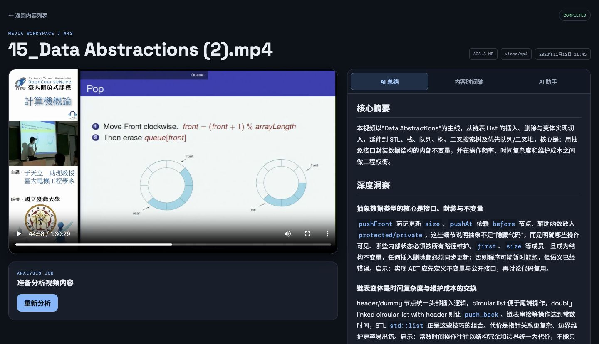
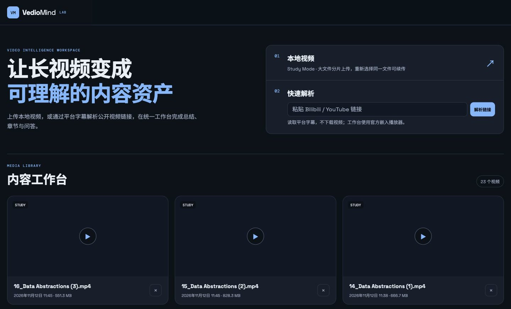
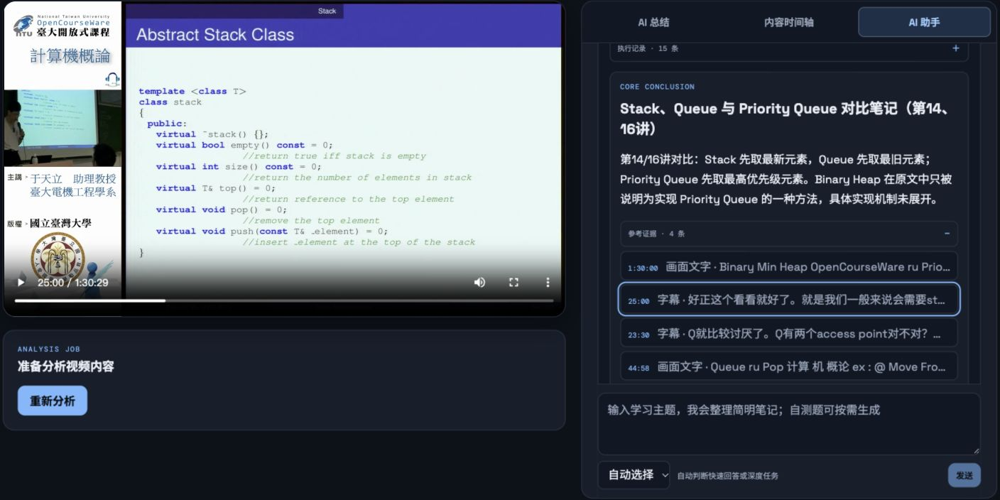
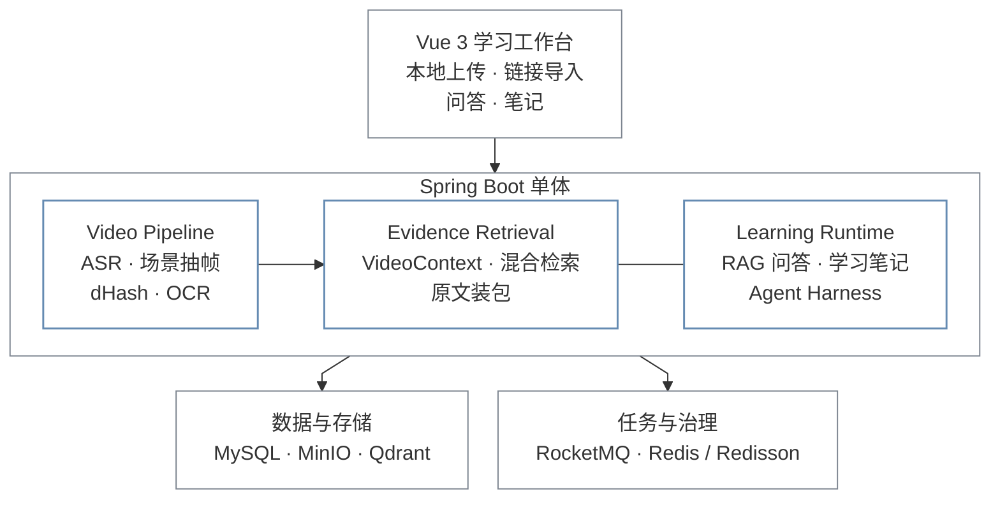
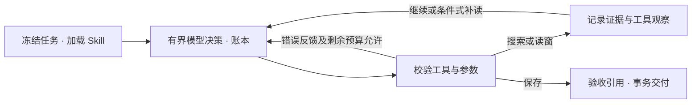

# VedioMind

**Evidence-grounded Video Learning Agent**

长视频的原始字幕容易撑满模型上下文，只做语音转写又会漏掉课件文字。VedioMind 把带时间戳的字幕和画面 OCR 组织成可检索的证据，用于视频总结、带引用问答和结构化学习笔记。读者可从引用跳回视频核对原文。

[产品展示](#产品展示) · [系统架构](#系统架构) · [Evaluation](#evaluation) · [Quick Start](#quick-start) · [Source Code & Testing](#source-code--testing)

## 产品展示

<p></p>
**视频工作台** · 左侧停在循环队列课件，右侧展示已有 AI 总结，可切换时间轴和 AI 助手。

<p></p>
**首页与媒体库** · 统一入口支持本地视频上传或公开链接解析。

<p></p>
**单视频深度学习笔记** · 真实部分交付的笔记节选，展示核心结论、原文引用和定位后的课件。

## 核心能力

| 能力 | 实现 |
| --- | --- |
| 视频接入 | 本地大文件通过预签名 S3 Multipart 直传 MinIO，支持断点续传。Bilibili / YouTube 链接导入平台字幕。 |
| 多模态处理 | 带时间戳 ASR 与场景抽帧、dHash 去重、OCR 并行，组装为版本化 `VideoContext`。 |
| 长视频 RAG | 向量与关键词混合检索，按命中区间回源并扩展邻域，按请求容量装入原文，返回可跳转引用。 |
| AI 学习助手 | 快速问答和结构化笔记共用持久化会话。异步任务可恢复，学生的会话与成果按归属隔离。 |
| 工程可靠性 | 事务消息协调任务创建与投递，Checkpoint 和调用账本管理恢复与预算，笔记交付支持幂等重放。 |

## 系统架构

Vue 3 工作台连接 Java 21 / Spring Boot **单体应用**。视频处理产出字幕和 OCR 证据，学习运行时在问答或写笔记时按需检索和读取原文。



MySQL 持久化证据和任务状态，MinIO 存放视频和关键帧，Qdrant 提供可重建的向量索引。RocketMQ 调度异步任务，Redis / Redisson 负责限流和并发控制。

## 核心工程设计

### Multimodal Video Pipeline

本地视频由 FFmpeg 提取音频与场景关键帧。音频送阿里云 Paraformer，视觉分支先用 dHash 去重，再对保留帧执行 Tesseract OCR 和质量过滤。ASR 分片与 OCR 使用受限并发，保留句级时间戳与帧位置。外链路径读取平台字幕，视觉模态标记为不适用。

字幕、关键帧、就绪知识块和任务进度分阶段持久化。重试复用已完成产物，视觉分支失败时仍可继续生成字幕侧结果。入口见 [分析消费者][consumer]、[视觉证据处理][visual] 和 [VideoContext][context]。

### Evidence-grounded RAG

索引绑定材料和处理版本。需要检索时，在获准材料及版本内生成查询向量并召回候选，结合关键词信号排序，回源到带时间戳的字幕或 OCR。问答优先装入放得下的完整原文，超预算时按任务范围走检索。装包对实际序列化请求做保守估算并预留输出，保存时验收引用是否来自该次可见证据。

默认本地长视频索引是 **v1 的 5 分钟知识块**，检索分支最多取 **4 块**，Qdrant 不可用时可回退 MySQL 精确扫描。v2 细粒度索引按指定媒体启用。下文 v3 的紧凑装包与 Rerank 是历史消融配置。入口见 [索引][index]、[检索][retrieval]、[证据窗口][evidence] 和 [请求预算][budget]。

### Agent Harness

单视频笔记沿用固定工作流。实验性的跨视频深度笔记采用 `bounded-study-v12`。宿主冻结权限、材料版本、交付槽和预算，预加载声明式 [course-notes Skill][skill]。模型通过原生工具调用搜索、阅读和保存，宿主校验工具参数，返回类别与 JSON Pointer 路径，并按剩余预算允许修正。收尾前若满足强来源缺口和预算条件，宿主可补读一次。保存只接受该轮请求发出前已对模型可见的原文。



实现入口见 [有界循环][runtime]、[工具校验][tools] 和 [条件式补读][supplement]。

### Reliable Execution

分析任务使用 RocketMQ 事务消息关联本地任务入库与消息投递，消费者用 Redisson 锁、数据库状态和执行代次隔离重复或过期执行。Redis 负责限流，可重试失败有带抖动的指数退避，额度等待和故障重试分别处理。Checkpoint 允许从已完成阶段继续。

调用账本在出网前预留预算，可复用同指纹的已确认响应。请求结果为 `UNKNOWN` 时保留预留并停止自动重投，远端调用结果可能仍未知。笔记通过幂等操作标识去重，正式成果、Run 终态和完成事件在同一数据库事务提交。入口见 [事务消息回查][transaction]、[任务接管][recovery]、[调用账本][ledger] 和 [成果交付][artifact]。

## Evaluation

- **约 90 分钟视频，同一素材单次本机对照。** 从 PCM 提取完成到 ASR 和视觉两分支结束，墙钟从 **1,120.390 s** 降到 **254.413 s**（**77.29%**）。原配置为单路 ASR、单路 OCR，复测为 5 路 ASR、6 路 OCR。
- **同一视频的抽帧漏斗。** 1 fps 均匀参考为 **5,430** 帧，场景抽帧选出 **198** 帧，dHash 后保留 **188** 帧（场景候选中去重 **5.05%**）。其中 **183** 帧检出文字，**161** 帧通过 OCR 质量门槛。

历史 RAG 对照使用同一长视频的 30 道锁定题，其中 10 道跨章节题。命中按知识块与标注时间区间相交计算。跨章节全覆盖统计最终装入 Prompt 的原文是否覆盖全部所需区间。

| 历史配置 | 命中题数 | 跨章节原文全覆盖 | 平均请求输入估算 Token |
| --- | ---: | ---: | ---: |
| v1 原混合，K=4 | 30/30 | 8/10 | 53,290.1 |
| v2 细粒度最终混合，K=6 | 29/30 | 8/10 | 29,822.4 |
| v3 紧凑装包、Rerank 与覆盖保护，K=6 | 29/30 | 10/10 | 23,324.8 |

同实验全量字幕基线为 **141,743.2** 估算 Token，v3 较该基线减少 **83.54%**，视觉组命中从 **10/10** 降到 **9/10**。本组只评价检索与装包，没有生成答案。

历史 E2E 跑了 **9 道快速问答和 2 份笔记**。首次原始输出同时通过结构和引用校验 **9/11**，末次 **10/11**。最终保存的 **55/55** 条引用可映射到已装入或已读原文及合法时间戳。两份笔记均为 `PARTIAL`。未读引用、工具数量和生成预算另有本地守卫回归。引用身份合规无法衡量主张的语义支持或回答正确率。

| N02 开发案例 | v9 | v10 | v11 | v12 |
| --- | ---: | ---: | ---: | ---: |
| 模型决策轮次 | 6 | 5 | 4 | 3 |
| 保存拒绝次数 | 3 | 1 | 0 | 0 |
| 供应商实际生成输入 Token | 40,111 | 30,069 | 21,546 | 16,313 |
| 供应商实际生成输出 Token | 4,377 | 3,755 | 1,829 | 1,782 |
| 宿主交付状态 | FAILED | PARTIAL | SUCCEEDED | SUCCEEDED |

N02 参与了调优，模型、任务硬预算和检索配置一致，每版只试跑一次。观察限于该开发案例。另有两道课内新题进行单轮 Workflow 与历史 v12 Agent 对照。两臂都交付 **2/2**，完整内容各 **0/2**。Workflow 生成 **2 次**，Agent **9 次**，Agent 完整覆盖了更多必要事实。两臂运行时段不同，参考事实及最终质量均为 AI 辅助审核。课程数据、完整报告和原始 Trace 仅本地保存。

## Quick Start

**环境** · JDK 21、Node.js 22.12+、Docker Compose、FFmpeg、Tesseract 及 `chi_sim` / `eng` 语言数据、yt-dlp。启用 AI 功能需配置 DeepSeek 和阿里云 API Key。

1. 从仓库根目录启动 [Docker Compose](docker-compose.yml)，检查 MySQL、Redis、Qdrant、MinIO 和 RocketMQ 的状态。

   ```bash
   docker compose up -d
   docker compose ps
   ```

2. 从仓库根目录复制 [后端配置模板](server/src/main/resources/application.example.properties)。设置密钥与本机工具路径，再初始化持久认证密钥。

   ```bash
   cp server/src/main/resources/application.example.properties server/src/main/resources/application.properties
   export DEEPSEEK_API_KEY='替换为你的 DeepSeek Key'
   export ALIYUN_API_KEY='替换为你的阿里云 Key'
   export FFMPEG_DIR="$(dirname "$(command -v ffmpeg)")"
   export TESSERACT_PATH="$(command -v tesseract)"
   export YTDLP_PATH="$(command -v yt-dlp)"
   ./scripts/auth-admin.sh init-key
   ```

3. 在同一个终端启动后端。首次启动时 Flyway 会在空库建表。

   ```bash
   cd server
   ./mvnw spring-boot:run -Dspring-boot.run.profiles=dev
   ```

4. 在另一个终端从仓库根目录启动前端，打开 [localhost:5173](http://localhost:5173) 注册并登录。Vite 将同源 `/api` 代理到本机 `9090`。

   ```bash
   cd client
   npm ci
   npm run dev
   ```

<details>
<summary>本地安全与旧数据库升级</summary>

- Compose 的默认凭据与端口映射仅用于本地开发。避免在共享网络暴露这些端口。MinIO 视频桶必须保持私有，预签名地址需要浏览器可达。生产部署使用 HTTPS 和默认 Secure Cookie，`dev` Profile 仅用于本地 HTTP。
- 认证密钥默认位于 `~/.vediomind/auth.key`，首次生成后持久保存。敏感配置仅写入环境变量或 Git 忽略的本地配置。已有密钥时直接复用。
- 旧库升级前先停止后端、确认无活动任务，盘点并备份。旧明文密码先按照 [认证工具][auth] 的 `audit`、`hash-passwords <new-encrypted-backup-file>` 流程转换，保留原密钥以便恢复。
- V18 私人学习数据先运行 [只读盘点][audit]。仅在确认全部旧材料都属于同一用户时，才运行 [归属转换脚本][upgrade]，显式传入已确认的用户 ID 和盘点得到的无会话 Run 数。多用户旧库需要单独制定转换清单，转换完成再启动后端。

</details>

## Source Code & Testing

| 想了解的链路 | 阅读入口 |
| --- | --- |
| 视频接入与分析 | [分片上传][upload] → [分析消费者][consumer] → [视觉证据][visual] |
| 长视频检索与问答 | [知识索引][index] → [混合检索][retrieval] → [会话问答][conversation] |
| 助手路由与工具执行 | [助手分发][dispatch] → [有界 Runtime][runtime] → [工具校验][tools] |
| 执行治理与成果 | [Run 控制][run-control] → [调用账本][ledger] → [成果交付][artifact] |

```bash
(cd server && ./mvnw test)
(cd client && npm ci && npm test && npm run build)
```

隔离 MySQL 验收从仓库根目录运行 `python3 scripts/test-study-agent-p1.py`，需 Python 3 和运行中的 Compose MySQL。脚本创建并清理临时库，验证迁移、权限隔离、调用预留与恢复、引用准入和原子交付，供应商行为由本地夹具提供。

## Limitations & Future Work

- 跨视频笔记仍处于实验阶段，尤其需要验证分散证据的获取与多目标语义覆盖。
- 视觉证据主要来自 OCR，课件图表关系与无文字画面需要主动视觉感知。
- 扩充跨课程保留集，并用新案例评估固定 Workflow 与 Agent 的自适应路由。

[upload]: server/src/main/java/com/example/server/service/MediaUploadService.java
[consumer]: server/src/main/java/com/example/server/consumer/VideoAnalysisConsumer.java
[visual]: server/src/main/java/com/example/server/service/VisualEvidenceService.java
[context]: server/src/main/java/com/example/server/service/context/VideoContextService.java
[index]: server/src/main/java/com/example/server/service/VideoKnowledgeIndexService.java
[retrieval]: server/src/main/java/com/example/server/service/VideoKnowledgeRetriever.java
[evidence]: server/src/main/java/com/example/server/service/VideoEvidenceContextService.java
[budget]: server/src/main/java/com/example/server/service/ai/AiPromptBudget.java
[conversation]: server/src/main/java/com/example/server/service/VideoConversationService.java
[dispatch]: server/src/main/java/com/example/server/service/AssistantDispatchService.java
[runtime]: server/src/main/java/com/example/server/service/StudyAgentRuntime.java
[tools]: server/src/main/java/com/example/server/service/StudyAgentToolDispatcher.java
[supplement]: server/src/main/java/com/example/server/service/StudyHostSupplement.java
[skill]: server/src/main/resources/skills/course-notes/SKILL.md
[transaction]: server/src/main/java/com/example/server/producer/AnalysisTransactionListener.java
[recovery]: server/src/main/java/com/example/server/service/BackgroundTaskRecoveryService.java
[run-control]: server/src/main/java/com/example/server/service/StudyRunControl.java
[ledger]: server/src/main/java/com/example/server/service/ai/AiCallLedger.java
[artifact]: server/src/main/java/com/example/server/service/StudyArtifactService.java
[auth]: scripts/auth-admin.sh
[audit]: scripts/study-agent-p0-audit.sh
[upgrade]: scripts/study-agent-p1-upgrade.sh
